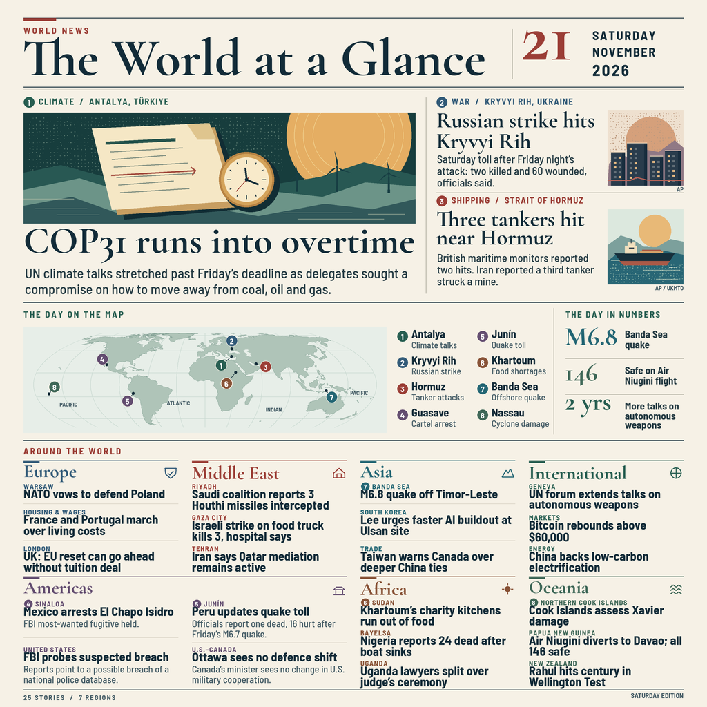

# The World at a Glance

[](https://make.fun/bounty/news-image-20261121)
[](https://make.fun/bounty/news-image-20261121)
[](https://make.fun/bounty/news-image-20261121)

**Saturday, 21 November 2026.** A single-image world-news edition for the make.fun bounty [Sum up 21 November’s world news in one image](https://make.fun/bounty/news-image-20261121).



## The edition

The front page covers **25 developments across seven desks**. COP31 in Antalya leads, with the casualty update from Kryvyi Rih and the tanker attacks near Hormuz alongside it. An eight-point atlas links reporting locations to the page. The news columns cover Europe, the Middle East, Asia, the Americas and Africa, plus Oceania and International.

The masthead uses **Cormorant Garamond**. The news labels and body use **Barlow Semi Condensed**. The palette pairs warm ivory and midnight blue with muted red, copper, forest green and teal. The illustrations use original geometric drawing, seeded stippling and antialiased line work. The clock, papers, apartment skyline and tanker are editorial symbols. Captions and copy carry the reported facts.

The atlas uses an Equal Earth projection scaled to a shallow newspaper panel. Its coastlines use Natural Earth’s public-domain 1:110 million land polygons. Small dots and short leaders anchor the numbered markers. The Hormuz marker identifies the strait and the Junín marker uses the Peruvian seismic agency’s epicentre. [Natural Earth land](https://github.com/nvkelso/natural-earth-vector/blob/v5.1.2/geojson/ne_110m_land.geojson) · [Natural Earth terms](https://www.naturalearthdata.com/about/terms-of-use/)

## Reporting ledger

[research/stories.json](research/stories.json) is the source for story copy, datelines, reporting links, cross-checks, mapped locations and illustration concepts. Each record states the basis for its Saturday inclusion and carries the earlier event date when relevant. The table lists Saturday developments and first reports. The Kryvyi Rih, Junín and Bayelsa entries cover new Saturday tolls after Friday events. The Warsaw item covers Saturday’s NATO response to Friday’s airspace breach. The UK item covers Saturday’s ministerial statement after Friday’s agreement.

| Desk | Saturday development | Source |
| --- | --- | --- |
| International | COP31 continues in overtime as delegates seek a fossil-fuel compromise | [The Guardian](https://www.theguardian.com/environment/live/2026/nov/21/cop31-climate-deal-latest-news-updates), [ITV News](https://www.itv.com/news/2026-11-21/nations-at-un-summit-in-turkey-working-overtime-on-climate-plans) |
| Europe | Kryvyi Rih officials give an updated toll after a Russian strike the previous night | [Associated Press](https://apnews.com/article/bfdee2ffadc2693e7338d6822e5356ef), [Hromadske](https://hromadske.ua/en/war/274752-russian-missiles-drones-strike-central-kryvyi-rih-killing-two-and-injuring-58) |
| Middle East | At least three oil tankers reported hit in or near the Strait of Hormuz | [Associated Press](https://apnews.com/article/29159a6f3365ff447c0ccbd1d7260f75), [UKMTO 215](https://www.ukmto.org/-/media/ukmto/products/20261121-ukmto_warning_215-26.pdf), [UKMTO 216](https://www.ukmto.org/-/media/ukmto/products/20261121-ukmto_warning_216-26.pdf) |
| Europe | Mark Rutte pledges NATO’s defence of Poland in Warsaw | [Reuters](https://www.internazionale.it/ultime-notizie-reuters/2026/11/21/nato-will-defend-every-inch-of-polish-territory-rutte-says), [Polish Radio](https://www.polskieradio.pl/395/7784/artykul/3755517%2Cnato-vows-to-defend-every-inch-of-polish-territory-after-airspace-violation) |
| Europe | People march in France and Portugal over housing and living costs | [Al Jazeera / AP / Reuters](https://www.aljazeera.com/news/2026/11/21/thousands-protest-across-europe-over-living-costs-and-housing), [Euronews](https://www.euronews.com/2026/11/21/thousands-take-to-streets-in-portugal-france-and-spain-over-rising-living-costs) |
| Europe | Ed Miliband says the UK–EU reset can proceed separately from tuition talks | [Anadolu Agency](https://www.aa.com.tr/en/europe/uk-eu-deal-will-go-ahead-regardless-of-tuition-fee-talks-foreign-secretary-says/4133017), [BBC News](https://www.bbc.co.uk/news/articles/cm9w9p4geke8o) |
| Middle East | Saudi-led coalition reports intercepting three Houthi missiles headed toward Riyadh | [Saudi Press Agency](https://spa.gov.sa/en/N2732732), [Reuters](https://theprint.in/world/saudi-arabia-says-it-intercepts-three-houthi-missiles-targeting-riyadh/3104825/) |
| Middle East | Gaza hospital director reports three killed after a strike hit a food truck | [Associated Press](https://apnews.com/article/29159a6f3365ff447c0ccbd1d7260f75) |
| Middle East | Iran says it remains in contact with Qatari mediators | [Associated Press](https://apnews.com/article/29159a6f3365ff447c0ccbd1d7260f75), [Reuters](https://www.internazionale.it/ultime-notizie-reuters/2026/11/21/qatari-delegation-visits-tehran-for-talks-iranian-official-says) |
| Asia | A magnitude-6.8 earthquake strikes in the Banda Sea northeast of Lospalos | [U.S. Geological Survey](https://earthquake.usgs.gov/earthquakes/eventpage/us6000ucij/executive) |
| Asia | South Korea’s Lee visits an Ulsan AI data-centre site and calls for speed | [Yonhap](https://m-en.yna.co.kr/view/AEN20261121001051320?section=national%2Fpolitics), [Reuters](https://new.streetinsider.com/Reuters/South%2BKorea%27s%2BLee%2Bsays%2Bspeed%2Bis%2Bvital%2Bin%2BAI%2Brace%2Bon%2Bdata%2Bcentre%2Bvisit/27382858.html) |
| Asia | Taiwan warns Canada of risks from deeper trade ties with China | [Associated Press](https://apnews.com/article/2e5eb3949e4c1a1d394363663791f883) |
| International | A UN forum agrees to continue work on autonomous weapons regulation for two years | [Swiss government](https://www.admin.ch/en/newnsb/cpYJGLEaQYIi), [Associated Press](https://apnews.com/article/ebe057d2a47cde53100970c8f648e7fa) |
| International | Bitcoin rebounds past US$60,000 in a Saturday quote | [Reuters](https://piqmarkets.com/reuters/bitcoin-rises-over-2-to-more-than-60000-2026-11-21-15-24-55) |
| International | Chinese climate delegate outlines support for low-carbon electrification | [The Guardian](https://www.theguardian.com/environment/2026/nov/21/china-commits-low-carbon-electrification-help-others-improve) |
| Americas | Mexican authorities capture Fausto Isidro Meza Flores in Sinaloa | [Associated Press](https://apnews.com/article/7301b67a1b1b974bc6bd20c9d030ce07) |
| Americas | Peru reports one death and 16 injuries after Friday’s M6.7 quake | [EFE](https://efe.com/mundo/2026-11-21/reporte-afectados-sismo-peru/), [INDECI](https://portal.indeci.gob.pe/wp-content/uploads/2026/11/BOLET%C3%8DN-INFORMATIVO-S%C3%8DSMICO-NACIONAL-N%C2%BA-819-2026-del-21-de-noviembre-de-2026.pdf) |
| Americas | FBI investigation of a possible national police database breach is reported | [Associated Press via CityNews](https://montreal.citynews.ca/2026/11/21/fbi-investigating-apparent-hack-of-a-key-criminal-justice-information-database-ap-source-says/) |
| Americas | Canada’s defence minister says he sees no change in U.S. military cooperation | [Canadian Press](https://globalnews.ca/news/12160884/canada-us-defence/), [Associated Press](https://apnews.com/article/1959fff46997c899f3c2bc2df7220ec6) |
| Africa | Khartoum volunteers describe charity kitchens shutting or running out of food | [Sudan Tribune](https://sudantribune.com/article/321506) |
| Africa | Nigeria’s emergency agency reports at least 24 dead after a Friday boat sinking | [Associated Press](https://apnews.com/article/ba1929311805c37ede05f8496f2826c0), [Nigeria State House](https://statehouse.gov.ng/president-tinubu-mourns-bayelsa-boat-victims/) |
| Africa | Ugandan lawyers divide over the chief justice’s thanksgiving ceremony | [Daily Monitor](https://www.monitor.co.ug/uganda/news/national/uls-snubs-chief-justice-zeija-s-thanksgiving-event-over-judicial-independence-detention-concerns-5656372), [ChimpReports](https://chimpreports.com/museveni-urges-kigezi-to-embrace-wealth-creation-as-he-honours-chief-justice-zeija/) |
| Oceania | Northern Cook Islands assess damage as Cyclone Xavier recedes | [Cook Islands News](https://www.cookislandsnews.com/internal/national/local/outer-islands/weather/islands-assess-damage-as-xavier-clears/) |
| Oceania | All 146 people aboard a Papua New Guinea-bound flight are safe after a Davao diversion | [Associated Press](https://apnews.com/article/a7626e8c97e7b829d3c825c15b5a50c4) |
| Oceania | India’s KL Rahul makes a century in the first Test in Wellington | [Press Trust of India](https://economictimes.indiatimes.com/news/sports/cricket/india-vs-new-zealand-test-ton-up-rahul-classy-devdutt-padikkal-take-india-to-344-for-2-at-tea/articleshow/136043475.cms), [New Zealand Cricket scorecard](https://archive.blackcaps.co.nz/Scorecards/1455/1455471.html) |

## Reproduction

The judging entrypoint is Python 3.13 with its standard library. It publishes the committed edition to `/output/entry.png`. Run locally with a different destination if needed.

```bash
MAKEFUN_OUTPUT_DIR=out python3 main.py
```

To regenerate the artwork, use Pillow 12.1.1 with the font and coastline files provided in the repository. The drawing step uses these local assets and the reporting ledger.

```bash
python3 artwork/render.py
```

Two isolated runs of the kit’s pinned **Python 3.13.17** image completed successfully with networking disabled and the repository mounted read-only. Both runs produced exactly one file, byte-identical to the committed full-resolution art.

| Output check | Result |
| --- | --- |
| Format | Valid 8-bit RGB PNG |
| Dimensions | 1024 × 1024 |
| Size | 640,931 bytes |
| SHA-256 | `59de21ca0c70d18b7be7c37ddf14c6c998374e1d6ebd0c5501f4e33eff88623c` |
| Visual inspection | 1024, 512, 300 and 256 pixels across |

Code and original artwork are MIT-licensed. The bundled fonts use the SIL Open Font License, with their notices in [assets/fonts](assets/fonts). [Cormorant Garamond](https://github.com/google/fonts/tree/main/ofl/cormorantgaramond) · [Barlow Semi Condensed](https://github.com/google/fonts/tree/main/ofl/barlowsemicondensed)
